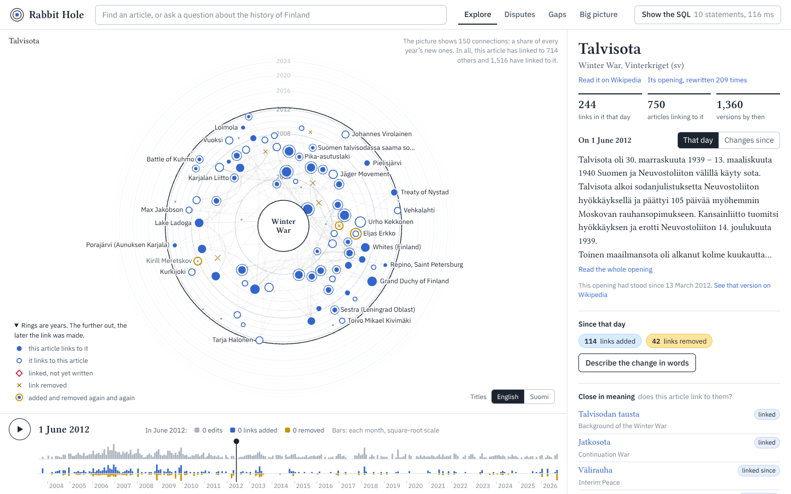
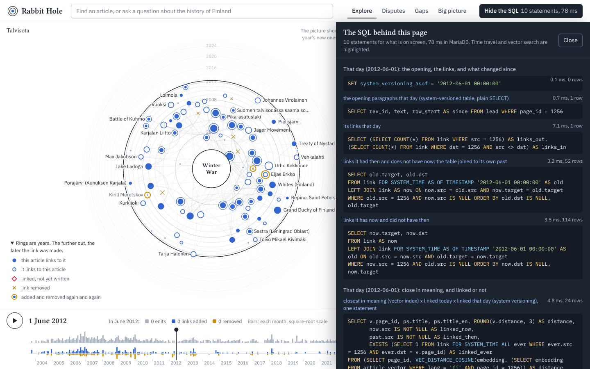
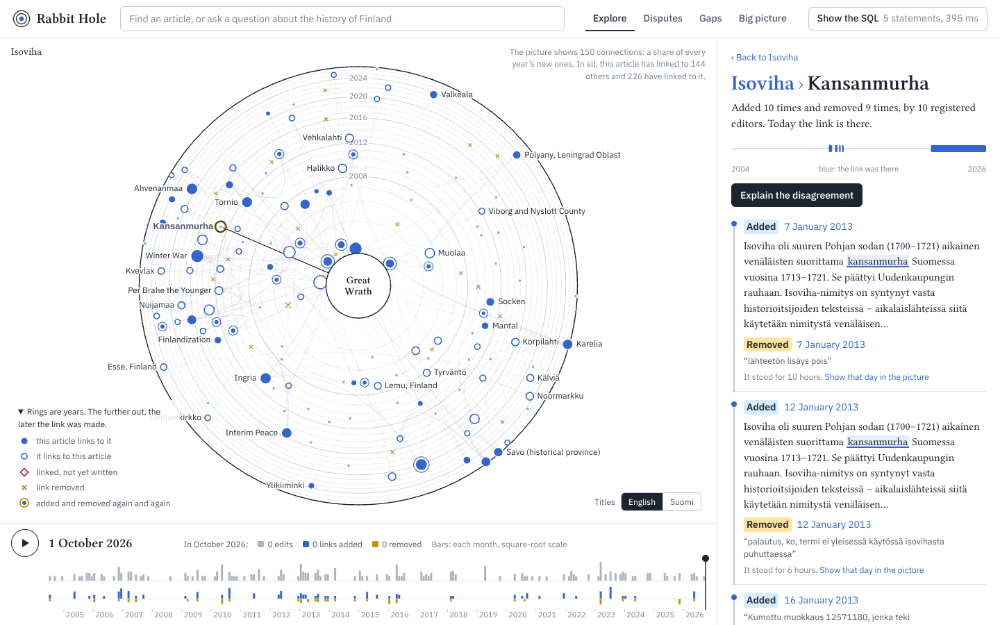

# Rabbit Hole: how Wikipedia's knowledge got connected, on MariaDB

> **Try it in the browser:** [rabbithole-lime-five.vercel.app](https://rabbithole-lime-five.vercel.app)
> is a snapshot: this same page replaying answers recorded from the database, with no database
> behind it. It says so on every view; [what is in it](#the-snapshot-the-app-where-there-is-no-database).
>
> **Status:** built and measured on **MariaDB 11.8.3** (Linux). `./setup.sh --local` ran from an
> empty folder to a working app; `./mac.sh` has run on one Apple-silicon Mac, from nothing to the
> open app; 53 automated tests pass (Python 3.9, 3.13 and 3.14); a scripted browser run clicks
> through every view without an error.
>
> **Not verified yet:** MariaDB 12 and 13 (`mariadb:lts` is 12.3, which the CI workflow is written
> to test but has not run on; Homebrew's plain `mariadb` is 13.0, which is why `mac.sh` installs
> `mariadb@11.8`); the download of Wikimedia's title list; the real bge-m3 embedding model and a
> real language model. In the tests a stand-in endpoint plays both models, so search quality with
> vectors is not measured here: `python pipeline/evaluate.py` measures it on your machine in a
> few seconds.
>
> **The pitch:** [nine slides](docs/rabbit-hole-pitch.pdf).

Wikipedia shows you an article, and the history of that article. It does not show how articles
got **connected**: who linked what to what and when, which connections editors fought over, and
which were never made.

Rabbit Hole reads all **862,076 saved versions** of 19,742 Finnish articles on the history of
Finland and keeps every link as a row in a **system-versioned table**, with the dates Wikipedia
itself recorded. The same articles have **vectors** in the same database. So one SQL statement
can ask: *which articles are closest in meaning to this one, does it link to them today, and
did it link to them in 2012?*

It is the two starter demos of this challenge put together
([vector search](https://github.com/MariaDB/mariadb-vector-wikipedia-rag) and
[system versioning](https://github.com/MariaDB/mariadb-system-versioning-wikipedia)),
with one thing neither has: the link graph, through time.



## Quick start

**On a Mac**, one command does all of it and opens the app (you need Homebrew or Docker):

```bash
./mac.sh
```

It uses Docker if Docker is running. Otherwise it installs Homebrew's `mariadb@11.8`, starts it
and Ollama as Homebrew services, and gives MariaDB the memory this needs. Then it runs the setup,
starts the app, and downloads the models last. The top of [mac.sh](mac.sh) lists everything it
changes outside this folder. Run it again later and it only starts the app.

**Anywhere else**, with Python 3.9 or later and Docker:

```bash
./setup.sh                          # packages, MariaDB in Docker, the datasets, the load
.venv/bin/python -m rabbithole      # http://localhost:8000
```

Without Docker, `./setup.sh --local` uses a MariaDB on the machine itself (11.8 or later) and
makes the database and the user "rabbithole" there. A fresh MariaDB has small memory settings:
everything works, but loading took 6 min 16 s instead of 2 min 44 s here, and a search 0.6 to
0.9 s instead of 0.04 s ([docs/measured/stock_settings.txt](docs/measured/stock_settings.txt)).
`--tune` fixes that for a Homebrew MariaDB; elsewhere, set `innodb_buffer_pool_size = 1G` and
`mhnsw_max_cache_size = 512M` in its configuration.

`setup.sh` downloads 460 MB (datasets S and M, and Wikimedia's list of all Finnish titles),
reads every version for its links, and loads MariaDB. From an empty folder on a 2-core machine
with a fast connection it took 5 min 17 s: about two minutes reading, two and a half loading,
half a minute deriving the small tables. It is safe to run again.

Two models make it better, and both are optional (`mac.sh` gets them itself):

```bash
ollama pull bge-m3      # turns a question into a vector. Without it: keyword search only.
ollama pull gemma4      # writes the answers. Without it: the sources are shown, no answer.
```

The answers can come from any OpenAI-compatible endpoint instead: set `LLM_BASE_URL`,
`LLM_API_KEY` and `LLM_MODEL` in `.env` (see [.env.example](.env.example)).

## What you can do with it

| View | What it answers | MariaDB underneath |
|---|---|---|
| **Explore** | How did this article get its connections? Rings are years: the further out, the later a link was made. Drag the timeline and the picture, the article's opening and its numbers move to that day. Double-click a neighbour to go down the hole. | `link FOR SYSTEM_TIME ALL` for the periods, `SET system_versioning_asof` for that day |
| **Changes since** | What is different today from that day: links added, links removed, the opening word by word. A language model can say it in words. | the link table joined to its own past |
| **Close in meaning** | The articles nearest in meaning to this one, and whether it links to them now, then, or ever did. Near in meaning and never linked is a link suggestion. | vector index and system versioning, one statement |
| **A link's story** | Every time one link was added and removed, by whom, with the sentence around it and the edit summaries. | `FOR SYSTEM_TIME ALL` joined to the edit log |
| **Disputes** | The 212 connections several editors added and several removed, and the articles whose openings were rewritten most. | built with `FOR SYSTEM_TIME ALL` |
| **Gaps** | For editors: central articles with no Swedish or English version, articles linked for years before anyone wrote them, titles linked today that nobody has written, articles nothing links to. | versioned link and page tables |
| **Ask** | A question in Finnish, Swedish or English, answered from the articles, with sources. Or from the articles **as they stood in 2010**. | hybrid search in one statement; the versioned `lead` table for the past |
| **Big picture** | The whole graph at the end of any year, asked live. | one `SET`, then ordinary joins over 561,066 links |
| **Show the SQL** | Every statement behind what is on screen, with its time and row count. | |



### A three-minute demo

1. Open the page. *Talvisota* (the Winter War) plays its history: links appear ring by ring, 2004 to 2026.
2. Drag the timeline to 2008. The panel shows the article of that day. Press **Changes since**.
3. Press **Show the SQL**. Point at the link table joined to its own past, and at the statement
   that mixes `VEC_DISTANCE_COSINE` with `FOR SYSTEM_TIME AS OF`.
4. **Disputes**, first row: *Isoviha › Kansanmurha*. Was the Russian occupation of 1713–1721 a
   genocide? The link went in ten times and out nine. Read the sentence and the edit summaries;
   **Explain the disagreement** has a model summarise both sides without taking one.
5. **Gaps › Not in Swedish**: what a Swedish-speaking reader is missing, most linked-to first.
6. Type a question in the search box. Under *Answer from Wikipedia as it stood*, choose **in 2010**.
7. **Big picture**: drag the year. Until 2007 the most linked-to article was *Jatkosota* (the
   Continuation War); since 2008 it is *Suomen sisällissota* (the Civil War).



## What we found

All of it is MariaDB 11.8.3. The tables come from three scripts in
[pipeline/experiments](pipeline/experiments): `versioning_checks.py`, `vector_history_depth.py`
and `vector_time_travel.py`; their outputs are in [docs/measured](docs/measured).

**1. Vector search and time travel work in one statement, and it is fast.** The 25 nearest
articles by vector, joined to today's link table, to the link table `AS OF` a date, and to
`FOR SYSTEM_TIME ALL`: 2.6 ms (the median of 7 calls). The vector part must stand alone in a
subquery with its own `ORDER BY … LIMIT` for the index to be used; the time travel happens in
the joins around it.

**2. One `SET` turns every query into a query about the past.** With
`SET system_versioning_asof`, the path finder (a three-way self-join of the link table) and the
"most linked-to articles" query run unchanged against any day since 2003. The whole graph as of
the end of 2010 (224,032 links between 9,612 articles) is counted and ranked in 0.5 s.

**3. But the setting does not reach every statement.**

| Under `SET system_versioning_asof = '2015-01-01'` | reads |
|---|---|
| `SELECT`, joins, subqueries, derived tables, CTEs, recursive CTEs, views | the past |
| `INSERT … SELECT` and `CREATE TABLE … AS SELECT` | **today**: the setting is ignored |
| the same with `FOR SYSTEM_TIME AS OF` written in the `SELECT` | the past |
| a statement prepared *before* the setting, executed under it | **today** |
| a statement prepared *under* the setting, executed after it is reset | **still the past** |

The second row bit us: yearly snapshots filled by `INSERT … SELECT` came out identical for
every year. [pipeline/analyze.py](pipeline/analyze.py) now selects first and inserts after. The last two rows
mean a prepared statement keeps the time it was prepared under, which matters for any connector
that prepares on the server. This app sends plain text statements.

**4. A vector index on a versioned table works. History costs time, and sometimes recall.**
A `VECTOR INDEX` can sit on a system-versioned table, history rows with vectors load through
`system_versioning_insert_history`, and `… FOR SYSTEM_TIME AS OF … ORDER BY
VEC_DISTANCE_COSINE(…) LIMIT 10` uses the index and always returned 10 rows. But the rows of all
periods share the one index, and that shows in two ways.

*Time grows with the depth of history.* 5,000 rows, each with 1, 3 or 9 near-duplicate versions
(as successive versions of an article are), searching the **current** rows with no time clause,
`mhnsw_ef_search = 80`:

| Versions per row | 1 | 3 | 9 |
|---|---|---|---|
| recall@10, median time | 100%, 1.2 ms | 100%, 4.3 ms | 97%, 17.6 ms |

*Recall falls when another period's version is closer to the question than the one asked for.*
19,285 rows with three versions each, the oldest a noisier copy than the newer two (we have no
embeddings of old text). Recall@10 against the exact answer, 60 questions each:

| `mhnsw_ef_search` | 80 | 200 | 400 | 800 |
|---|---|---|---|---|
| today (the newest version) | 99%, 9.2 ms | 99%, 5.4 ms | 99%, 8.6 ms | 100%, 13.2 ms |
| as of 2016 (the middle version) | 99%, 5.1 ms | 99%, 6.6 ms | 100%, 12.0 ms | 100%, 19.7 ms |
| as of 2008 (the oldest version) | **71%**, 22.6 ms | 82%, 32.5 ms | 87%, 50.4 ms | 92%, 71.4 ms |
| the same 2008 vectors alone in a plain table | 97%, 3.9 ms | 99%, 2.3 ms | 100%, 3.0 ms | 100%, 4.1 ms |
| as of 2008 with `IGNORE INDEX`: every row compared | 100%, 107.8 ms | | | |

Raising `ef_search` buys the recall back slowly; at 800 the index takes two thirds of the time of
comparing every row, which is exact. Both tests use made-up history, so read the direction, not
the digits. Also: **a partitioned table cannot have a vector index** ("Partitioned tables do not
support VECTOR"), so `PARTITION BY SYSTEM_TIME` does not separate the periods. This is why
Rabbit Hole keeps its vectors unversioned and does its time travel in the link and text tables.

**5. Loading history with real dates is quick.** 757,913 link periods, 203,318 versions of
opening paragraphs and 19,742 pages went into versioned tables with Wikipedia's own timestamps
in about a minute (`system_versioning_insert_history`). `TIMESTAMP '2012-06-01'` is refused in
`FOR SYSTEM_TIME AS OF`: the literal needs a time of day. And two settings decide the speed of
everything else: with the 16 MB default of `mhnsw_max_cache_size` the vector index took 224 s to
build instead of 42 s, and `SET GLOBAL innodb_buffer_pool_size` cannot grow the pool past the
size the server started with, so that one has to be in the configuration.

**6. About Wikipedia itself.**

- 733,009 different links were ever made; 171,943 of them (**23%**) are gone for good.
- 132,557 times a link vanished and came back within 48 hours (blanking, vandalism, its revert).
  Counted naively these would be breaks in a link's life. Here they are not.
- **212 connections were fought over**: added by at least two registered editors and removed by
  at least two, in edits that were about that link. 92 of them are in the article today.
- 2,596 articles were linked from at least two others before anyone wrote them. On average they
  waited 3.2 years.
- Of the 19,285 Finnish articles with text in the dataset, 13,954 have no Swedish version there
  and 13,621 no English one. 5,095 articles are not linked from any other article of the set.

## How it is built

```
dataset M: 862,076 versions (wikitext) ──► pipeline/extract.py ──► link periods, edit log,     ─┐
                                                                    versions of the opening      │
dataset S: text of Aug 2025 + bge-m3 vectors ───────────────────────────────────────────────────┼─► pipeline/load.py ─► MariaDB
all titles of fi.wikipedia (to tell a red link from a link out of the topic) ───────────────────┘        │
                                                                                         pipeline/analyze.py: yearly snapshots,
                                                                                         contested links, gaps (all SQL)
rabbithole/app.py: a JSON API (Flask), every answer carries its SQL ◄── rabbithole/queries.py ◄──────────┘
rabbithole/static: one page, no build step (D3 for the layout, canvas for the rings)

pipeline/snapshot.py ─► rabbithole/snapshot/ ─► rabbithole/replay.py: the same page where there is no database
```

**Reading the links** ([rabbithole/wikitext.py](rabbithole/wikitext.py),
[pipeline/extract.py](pipeline/extract.py)). Every `[[link]]` of every version is compared with
the version before. A link that appears opens a period; one that disappears closes it, unless it
is back within 48 hours. The sentence around each new link is kept, and so is every version of
the opening paragraphs as plain text.

**The tables** ([pipeline/schema.sql](pipeline/schema.sql)). Three are system-versioned and
loaded with Wikipedia's dates as `row_start` and `row_end`:

```sql
CREATE TABLE link (
  src       INT UNSIGNED NOT NULL,           -- the article the link is in
  target    VARCHAR(255) NOT NULL,           -- the title it points to; may not exist (a red link)
  dst       INT UNSIGNED,                    -- that article's id, when it is one of ours
  start_rev INT UNSIGNED,                    -- the version that added it
  end_rev   INT UNSIGNED,                    -- the version that removed it; NULL while the link is alive
  row_start TIMESTAMP(6) GENERATED ALWAYS AS ROW START INVISIBLE,
  row_end   TIMESTAMP(6) GENERATED ALWAYS AS ROW END INVISIBLE,
  PERIOD FOR SYSTEM_TIME (row_start, row_end),
  PRIMARY KEY (src, target), KEY (dst), KEY (target)
) CHARACTER SET utf8mb4 COLLATE utf8mb4_bin WITH SYSTEM VERSIONING;
```

`page` (an article exists from the day it was written) and `lead` (the opening paragraphs) are
versioned the same way. `revision` is the edit log, `link_context` the sentences,
`article` and `article_vector` are dataset S as in the RAG starter (`VECTOR(1024)`,
`VECTOR INDEX … M=16 DISTANCE=cosine`, and a `FULLTEXT` index).

**Three statements worth reading** (all in [rabbithole/queries.py](rabbithole/queries.py)):

```sql
-- Close in meaning, and linked or not: both tracks in one statement
SELECT v.page_id, ps.title, ROUND(v.distance, 3) AS distance,
       now.src  IS NOT NULL AS linked_now,
       past.src IS NOT NULL AS linked_then,
       EXISTS (SELECT 1 FROM link FOR SYSTEM_TIME ALL ever
               WHERE ever.src = 1256 AND ever.dst = v.page_id) AS linked_ever
FROM (SELECT page_id, VEC_DISTANCE_COSINE(embedding,
               (SELECT embedding FROM article_vector WHERE lang = 'fi' AND page_id = 1256)) AS distance
      FROM article_vector WHERE lang = 'fi' ORDER BY distance LIMIT 25) AS v
JOIN page_stat ps ON ps.page_id = v.page_id
LEFT JOIN link AS now ON now.src = 1256 AND now.dst = v.page_id
LEFT JOIN link FOR SYSTEM_TIME AS OF TIMESTAMP '2012-06-01 00:00:00' AS past
       ON past.src = 1256 AND past.dst = v.page_id
WHERE v.page_id <> 1256 ORDER BY v.distance;

-- Links the article had that day and does not have now: the table joined to its own past
SELECT old.target FROM link FOR SYSTEM_TIME AS OF TIMESTAMP '2012-06-01 00:00:00' AS old
LEFT JOIN link AS now ON now.src = old.src AND now.target = old.target
WHERE old.src = 1256 AND now.src IS NULL;

-- The whole graph on a past day: one setting, then SQL that knows nothing about time
SET system_versioning_asof = '2010-12-31 23:59:59';
SELECT p.title, COUNT(*) AS links_in FROM link l JOIN page p ON p.page_id = l.dst
WHERE l.dst <> l.src GROUP BY p.page_id ORDER BY links_in DESC LIMIT 10;
```

**Search** is the hybrid the RAG starter lists as an idea: the vector result and the `FULLTEXT`
result fused by rank (Reciprocal Rank Fusion) in one statement, grouped so that the Finnish,
Swedish and English versions of an article count as one topic. Then one step the graph allows:
articles that several results link to together are added to the sources (ask about a presidency,
find the elections; they all link to the president).

## Numbers

MariaDB 11.8.3 with the settings in [docker-compose.yml](docker-compose.yml) (1 GB buffer pool),
on a 2-core Linux machine with 7 GB of memory. Your laptop is probably faster.

| | |
|---|---|
| Versions read | 862,076, of 19,742 articles, 21 February 2003 to 1 October 2026 |
| Editors (accounts and IP addresses) | 73,436; 19% of versions are anonymous |
| Link periods (rows in `link` with history) | 757,913: 561,066 current + 196,847 history |
| Versions of opening paragraphs | 203,318 |
| Sentences around links | 756,661 |
| Articles with text and vectors (dataset S) | 29,460: 19,285 fi, 5,254 en, 4,921 sv |
| Database size | 1,283 MB: `link_context` 402, `link` 189, `revision` 184, `article_vector` 154, `article` 152, `lead` 150 |
| Reading all versions for links | 136 s |
| Loading MariaDB | 164 s: articles 31, vectors 42, graph 41, edit log 26, openings 20, titles 5 |
| Derived tables | 36 s |

`python pipeline/measure.py`, 7 runs each, the SQL only (a first call after a restart is slower):

| Question | Statements | Median |
|---|---|---|
| An article and its timeline | 1 | 1.0 ms |
| Its connections through time (150 of them, every period) | 3 | 40 ms |
| The article as of a day: opening, counts, links added and removed since | 5 | 13 ms |
| Nearest in meaning × linked today × linked that day × ever | 1 | 2.6 ms |
| The life of one link | 1 | 0.8 ms |
| Shortest way between two articles, today / as of 2008 | 3 / 4 | 1.1 ms / 2.8 ms |
| The whole graph as of the end of 2010 | 3 | 463 ms |
| Hybrid search: vector + full text, fused | 1 | 37 ms |
| Keyword search alone | 1 | 39 ms |

The outputs these tables were copied from are in [docs/measured](docs/measured).

**Search quality** on the 37 test questions of dataset S, `python pipeline/evaluate.py`:

| Mode | hit@1 | hit@5 | hit@10 | MRR |
|---|---|---|---|---|
| Keyword search alone (measured here) | 8% | 16% | 38% | 0.13 |
| Vector alone, hybrid, hybrid + follow the links | *run it with bge-m3 in Ollama* | | | |

For comparison, the RAG starter reports 16% (keyword) and 76% (vector) for hit@5 on the same
questions.

## The snapshot: the app where there is no database

A static host runs a web page and nothing else. For such a place the repository carries a
**snapshot**: 46,310 answers of the app's own API, recorded from MariaDB with the SQL and
the timing of every statement, and a replay mode that serves them back.

```bash
python pipeline/snapshot.py          # record: about two minutes, needs the loaded database
SNAPSHOT=1 python -m rabbithole      # replay: the same page, and no database is opened
```

On Vercel the replay is on by itself when no `DB_HOST` is set. The page says what it is on every
view: a line under the top bar, "as recorded" where the live app says "asked live", and a page
of its own that lists what is in it (`#/snapshot`).

| In the snapshot (`rabbithole/snapshot/`, 20 MB) | How deep |
|---|---|
| Big picture, disputes, gaps | whole: the same lists the live app shows |
| 16 articles, month by month | the first day of every month of the article's life, its opening through the years, the story of every link in its picture |
| 144 articles, year by year | the last day of every year, the story of every link in the picture |
| 801 articles, as they stand today | the page, its picture (which still plays the whole history), today's text |

What it leaves out, and how it says so:

- **Every other day and article.** A day that was not recorded is answered with the last recorded
  day before it, and the reply names both days. Nothing is interpolated. An article that was not
  recorded gets a page that says so; its links are grey wherever they appear.
- **Questions, explanations and routes.** A language model writes the first two per request and
  MariaDB works out a route per pair of articles and day. A replay cannot do either.
- **Editors' names.** The live API returns user names, and IP addresses for unregistered editors.
  A snapshot is a public copy, so the recorder drops both and writes `[editor]` where an edit
  summary named someone. Every edit still links to Wikipedia, where its author is credited.

Nothing is computed from the data again: [rabbithole/replay.py](rabbithole/replay.py) finds a
recorded answer or says it has none. The one exception is the title box, a prefix match over the
recorded titles.

## Tests

```bash
docker compose up -d --wait
.venv/bin/python -m unittest discover -s tests -v
```

- **`tests/test_pipeline.py`** runs the whole pipeline on a Wikipedia of four articles whose
  history is written out in [tests/fixture.py](tests/fixture.py): a disputed link, a page that
  was blanked for an hour, an article linked for years before it was written. Then it checks the
  tables with `AS OF` queries and every API route. It uses its own database, `rabbithole_test`.
- **`tests/test_wikitext.py`**: links, redirects, nested templates, the sentence around a link.
- **`tests/test_llm.py`**: the chat client against a stand-in endpoint: one that refuses unknown
  settings, one that sends its thinking in the text, one that is not there.
- **`tests/test_replay.py`**: the snapshot answering every view with database access switched
  off: a day between two recorded days, an article kept only as it stands today, a link story
  with no editor named, and what it says about the things it does not have.
- **`.github/workflows/tests.yml`** runs all of it against `mariadb:11.8` and `mariadb:lts`, on
  GitHub's runners or on CRACI (set the repository variable `RUNNER` to `craci`). Start it from
  the Actions tab. Written, not yet run.

## Limits

- **Links are found with a regular expression**, not MediaWiki's parser. Links made by templates
  are missed; links inside templates, tables and references are found and marked.
- **A link's target is matched by today's title.** A page that was renamed keeps its links under
  the old title, and redirects are not followed: a link to a redirect does not count as a link to
  the article it leads to.
- **The vectors are of today's text** (August 2025). "Close in meaning" compares articles as they
  are now, while "linked that day" is true to the day. Finding 4 is why, together with the fact
  that the challenge data has no vectors of old text.
- **Answers about the past** are written from the opening paragraphs of that day, not the whole
  article: openings are the part kept as plain text for every version.
- **"Linked before written" and "wanted now" are leads, not facts.** A title that was a
  redirect before it became an article looks like a red link turned blue. "Wanted now" needs
  Wikimedia's list of all titles; if `setup.sh` could not download it the list stays empty, and
  the page says how to fill it.
- **Contested does not mean important.** The measure finds links people disagreed over. Some are
  about a genocide, some about a TV satire. The page says what happened, not who was right.
- One topic, one language of history: Finnish articles on the history of Finland.

## Thanks and licences

Code: MIT ([LICENSE](LICENSE)). Text and edit history: Finnish, Swedish and English Wikipedia and
their editors, [CC BY-SA 4.0](https://creativecommons.org/licenses/by-sa/4.0/), through the
[MariaDB Foundation's datasets](https://github.com/MariaDB/mariadb-wikipedia-datasets) for the
Junction 2026 challenge *Wikipedia Through Time*. D3 and the fonts:
[rabbithole/static/vendor/NOTICE.md](rabbithole/static/vendor/NOTICE.md).
Rabbit Hole is not part of Wikipedia or the Wikimedia Foundation.
